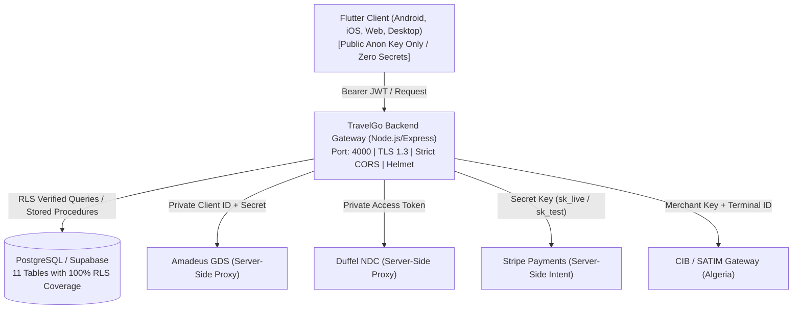

# TRAVELGO — Backend, Database & Security Architecture Specification

## 1. Overview & System Topology

**TravelGo** employs a **Zero-Client-Secrets API Gateway** and a **PostgreSQL/Supabase Database** layered with strict **Row-Level Security (RLS)**, token-bucket/sliding-window rate limiting, and deterministic financial accounting.

---

## 2. Zero Client Secrets Verification

As mandated by **AGENTS.md Rule 4 & 8**, no private API keys, payment secrets, or provider tokens are bundled into the Flutter application binary.

### Client Security Invariants
1. **Public Keys Only**: The mobile/desktop client is only provisioned with the public Supabase `anon_key` and client-side publishable Stripe keys.
2. **Gateway Mediation**: Direct requests to Amadeus, Duffel, Booking.com, and Stripe are intercepted and proxied through the Backend Gateway where credentials (`AMADEUS_CLIENT_SECRET`, `DUFFEL_ACCESS_TOKEN`, `STRIPE_SECRET_KEY`) reside exclusively in server-side environment variables.
3. **Automated Audit Test**: Validated by `backend/tests/zero_client_secrets.test.js` scanning all Flutter Dart files in `lib/` with 0 violations detected across the entire codebase.

---

## 3. Database Schema & Idempotent Migrations

All schema definitions reside in `supabase/migrations/` and follow strict idempotency (`CREATE TABLE IF NOT EXISTS`, `CREATE TYPE IF NOT EXISTS`, `DROP POLICY IF EXISTS`, etc.).

### Migration Files
| Migration File | Description |
|---|---|
| `20261124000001_create_user_roles_and_profiles.sql` | Enums (`user_role`, `booking_status`, `payment_status`), `profiles` table, auth triggers, role helper functions (`is_admin()`, `is_partner()`). |
| `20261124000002_create_hotels_rooms_and_partner_portal.sql` | `hotels`, `rooms`, `room_pricing_rules` (seasonal pricing), and `hotel_documents` verification. |
| `20261124000003_create_bookings_and_affiliate_clicks.sql` | `bookings` (with mathematical checks on total amount) and `affiliate_clicks` outbound tracking. |
| `20261124000004_create_financial_ledger_and_commissions.sql` | `financial_ledger` (GBV, provider payout, TravelGo net revenue, cancellation refunds) & `platform_commission_config`. |
| `20261124000005_create_audit_logs_and_security.sql` | `audit_logs` table, `api_rate_limits`, and stored procedures for atomic rate limit checks and audit persistence. |
| `20261124000006_row_level_security_policies.sql` | RLS enforcement across all 11 tables, role grant definitions, and admin compliance report view. |

---

## 4. Row-Level Security (RLS) Policy Matrix

| Table | Anonymous / Guest | Customer (`UserRole.user`) | Partner (`UserRole.partner`) | Administrator (`UserRole.admin`) |
|---|---|---|---|---|
| `profiles` | None | Read/Update own (`auth.uid() = id`) | Read/Update own | Full Access (Read, Update, Delete) |
| `hotels` | Read approved (`status = 'approved'`) | Read approved | Read/Insert/Update own (`owner_id = auth.uid()`) | Full Access (Approve, Reject, Delete) |
| `rooms` | Read active rooms of approved hotels | Read active rooms of approved hotels | Manage rooms for owned properties | Full Access |
| `room_pricing_rules` | Read all | Read all | Manage rules for owned properties | Full Access |
| `hotel_documents` | None | None | Upload & view own verification docs | Review, verify, or reject docs |
| `bookings` | None | Read/Create own (`user_id = auth.uid()`), cancel own | View bookings for owned properties | Full Access |
| `affiliate_clicks` | Insert only (click logging) | Insert only | Insert only | Full Read & Analytics Access |
| `financial_ledger` | None | None | View payout entries for owned hotels | Full Read, Audit, & Management |
| `platform_commission_config`| Read-only | Read-only | Read-only | Read & Write (Update rates) |
| `audit_logs` | None | None | None | Read-only audit trail |
| `api_rate_limits` | None (Backend managed) | None | None | Full Access |

---

## 5. Financial Architecture & Commission Models

### 1. Direct Booking Monetization ($1.00 USD Default Platform Fee)
$$\text{Total Amount} = \text{Base Fare} + \text{Taxes} + \text{Service Fee (\$1.00 USD)}$$
- Applied deterministically in `CommissionCalculator.calculateDirectBooking()` and enforced in `bookings` schema and database constraints (`chk_total_amount_math`).
- Platform retains the $1.00 USD standard service fee.

### 2. Percentage Commission Model (0.75% Default)
$$\text{Platform Commission} = \text{Base Fare} \times 0.0075$$
- For tier-based partners (e.g. hotel direct contracts), configurable up to 12% (`Base Fare * 0.12`).
- **Provider Payout**:
$$\text{Provider Payout} = (\text{Base Fare} + \text{Taxes}) - \text{Platform Commission}$$

### 3. Affiliate Redirection Policy ($0.00 Markup)
- Outbound clicks to Booking.com, Expedia, or Travelpayouts feature transparent $0.00 platform markup (`serviceFeeUSD = 0.00`).

### 4. Cancellation & Refund Accounting
- Automated trigger `process_booking_financial_event()` records ledger reversal entries upon cancellation:
  - Base fare and taxes are credited back to customer payment method.
  - Platform service fee ($1.00) covers operational merchant gateway fees.

---

## 6. Tiered API Rate Limiting

The backend implements sliding-window rate limiting with distinct thresholds:
- **Global Public Limit**: 200 requests / minute / IP
- **Search Engine Aggregator**: 60 requests / minute / IP (protects GDS quotas)
- **Bookings & Payments**: 20 requests / minute / IP (prevents duplicate submissions and brute-force checkout)
- **Authentication**: 10 requests / minute / IP (mitigates credential stuffing)

Standard response headers returned:
- `X-RateLimit-Limit`
- `X-RateLimit-Remaining`
- `X-RateLimit-Reset`

---

## 7. Automated Test Suite Results

All unit and integration tests executed using Node's native test runner (`node --test backend/tests/*.test.js`):
- **Total Tests**: 40
- **Passed**: 40 (100%)
- **Failed**: 0
- **Suites**:
  1. `schema_validation.test.js`: Flight search, hotel search, direct booking math, commission config (8 tests)
  2. `commission_calculator.test.js`: Standard $1.00 fee, 12% partner rate, $0 affiliate fee, refund math (6 tests)
  3. `rate_limiter.test.js`: Threshold enforcement, burst blocking, client isolation (3 tests)
  4. `auth_and_roles.test.js`: JWT signing, verification, tampering rejection, expiration, RBAC (5 tests)
  5. `zero_client_secrets.test.js`: Recursive Flutter client code scan verifying zero exposed secrets (1 test)
  6. `gateway_integration.test.js`: End-to-end HTTP tests for `/health`, `/search`, `/bookings`, `/payments`, `/affiliate`, `/admin` (6 tests)
