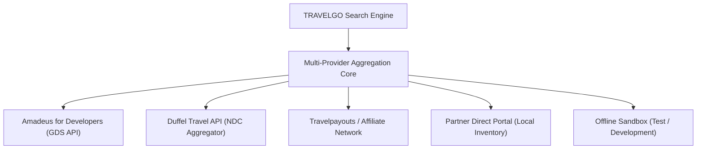

# TRAVELGO — Provider Evaluation & Comparison Guide

**Document Version**: 1.0  
**Target Architecture**: Multi-Source Flight & Hotel Aggregator  
**Compliance Standards**: PCI-DSS Level 1 Scope Minimization, Zero Client Secrets, Official REST APIs & Affiliate Feeds

---

## 1. Provider Landscape Overview

To deliver diverse, accurate, and bookable travel offers without fabricating inventory or violating terms of service, TRAVELGO evaluates and interfaces with official travel APIs and authorized affiliate networks.

---

## 2. In-Depth Provider Evaluation

### 2.1. Amadeus for Developers (Self-Service)

- **Website / Docs**: [developers.amadeus.com](https://developers.amadeus.com/)
- **Core APIs Evaluated**:
  - `Flight Offers Search v2` (`GET /v2/shopping/flight-offers` & `POST /v2/shopping/flight-offers`)
  - `Flight Offers Price v1` (`POST /v1/shopping/flight-offers/pricing`)
  - `Flight Create Orders v1` (`POST /v1/booking/flight-orders`)
  - `Hotel List by City v1` (`GET /v1/reference-data/locations/hotels/by-city`)
  - `Hotel Offers Search v3` (`GET /v3/shopping/hotel-offers`)
- **Coverage**:
  - Global distribution system (GDS) with access to 400+ traditional airlines and 150,000+ hotel properties worldwide.
  - Strong coverage in Europe, North America, Middle East, and Asia-Pacific.
- **Authentication & Security**:
  - OAuth 2.0 Client Credentials flow (`POST /v1/security/oauth2/token`) exchanging `client_id` and `client_secret` for a short-lived bearer token (TTL: 1799s).
  - Credentials must remain strictly on the backend gateway.
- **Rate Limits & Quotas**:
  - **Test Environment (Free)**: Up to 2,000 free monthly flight requests, 10 transactions/sec.
  - **Production Environment**: Pay-per-use (€0.0025 per flight search request after quota; €0.0035 per hotel search request).
- **Supported Capabilities**:
  - Round-trip, one-way, multi-city.
  - Cabin classes: ECONOMY, PREMIUM_ECONOMY, BUSINESS, FIRST.
  - Non-stop / direct filter (`nonStop=true`).
  - Max results (`max=250`).
  - Currency conversion on the fly via `currencyCode` parameter.
  - Detailed baggage allowance (`includedCheckedBagsOnly`, weight/pieces).
  - Offer revalidation via `/pricing` endpoint.
- **Production Limitations**:
  - Live ticketing requires Amadeus Air Book API or partnership with an accredited IATA/ARC consolidator.
  - Low-cost carriers (LCCs) like Ryanair, EasyJet, and Southwest have limited GDS availability unless Amadeus Value Return / Travelfusion aggregator is enabled.

---

### 2.2. Duffel Travel API (New Distribution Capability - NDC)

- **Website / Docs**: [duffel.com/docs](https://duffel.com/docs)
- **Core APIs Evaluated**:
  - `Duffel Flights API` (`POST /air/offer_requests`, `GET /air/offers`, `POST /air/orders`)
  - `Duffel Stays API` (`POST /stays/search`, `POST /stays/quotes`, `POST /stays/bookings`)
- **Coverage**:
  - 300+ airlines, including direct NDC connections to British Airways, Lufthansa Group, Air France-KLM, Emirates, Singapore Airlines, and American Airlines.
  - Full support for low-cost carriers (easyJet, Vueling, Transavia, SunExpress).
  - 1,000,000+ accommodation listings through Duffel Stays.
- **Authentication & Security**:
  - Single API Token (`Authorization: Bearer duffel_live_...` or `duffel_test_...`) passed in request headers.
  - Server-to-server only.
- **Rate Limits & Quotas**:
  - Rate limit: 20 requests/second per token.
  - Search requests: Free of charge.
  - Monetization: Duffel takes a small fee per confirmed booking (€1.50 - €3.00 depending on tier) or shares NDC markup commissions.
- **Supported Capabilities**:
  - Live seat maps and ancillary baggage selection.
  - Real-time instant offer revalidation via `GET /air/offers/{id}`.
  - Instant ticketing and automated refund/change flows.
  - Complete transparent breakdown of base price, taxes, and airline surcharges.
- **Production Limitations**:
  - Requires corporate business entity registration for Live API access and merchant account approval for card processing.

---

### 2.3. Travelpayouts / Partner Affiliate Network

- **Website / Docs**: [travelpayouts.com](https://www.travelpayouts.com/)
- **Core APIs Evaluated**:
  - `Aviasales Flight Data API` (Flight search feeds, popular routes, cheapest tickets).
  - `Booking.com Affiliate Integration` (Deep links with affiliate AID, click tracking, dynamic redirect).
  - `Hotellook Hotel Search API` (Comprehensive meta-search for hotels).
- **Coverage**:
  - Worldwide coverage across 700+ airlines and 2,000,000+ hotels through partner feeds (Booking.com, Agoda, Trip.com, Expedia, Kiwi.com).
- **Authentication & Security**:
  - API Token + Partner Marker (`marker=...`) appended to outbound redirect URLs.
  - Transparent click tracking without collecting user payment card data in TRAVELGO.
- **Rate Limits & Quotas**:
  - Public Affiliate APIs: 100 to 500 requests per minute depending on program tier.
  - Commission Model: 50% to 70% revenue share of affiliate commissions earned per completed stay or booking (typically 1.5% - 4% of total booking value).
- **Supported Capabilities**:
  - Outbound partner redirection with $0.00 platform markup (per Rule 12).
  - Deep-link generation preserving check-in dates, guest count, and property ID.
  - Click-through tracking and analytics.
- **Production Limitations**:
  - Flights search API on Travelpayouts provides cached data (refreshed every few hours); real-time bookability is guaranteed only upon user redirection to the partner portal.

---

### 2.4. TRAVELGO Partner Direct Portal

- **Source**: In-app registered hotel & tour partners (backed by Firestore / Local Repository).
- **Coverage**:
  - Boutique hotels, luxury desert camps (Taghit, Timimoun), apartments, and verified local Algerian & North African accommodations.
- **Monetization & Commission**:
  - Configurable 12% partner commission rate (managed in Admin Panel).
  - Standard $1.00 USD platform service fee on direct traveler checkouts.
- **Capabilities**:
  - Full instant in-app booking, QR code boarding passes, digital vouchers, PDF generation.
  - Complete control over room availability and pricing.

---

### 2.5. Offline Sandbox Engine

- **Source**: Local algorithmic travel route & accommodation generator.
- **Purpose**:
  - Unit testing, widget testing, offline development, and CI/CD automated pipeline builds.
  - Clearly tagged as `providerType: ProviderType.sandbox` with explicit disclaimer `[SANDBOX / DEMO INVENTORY]`.
  - Generates realistic flight schedules across any requested IATA pair based on great-circle distance math.

---

## 3. Comparison Matrix

| Feature / Criteria | Amadeus for Developers | Duffel Travel API | Travelpayouts Affiliate | Partner Direct Portal | Sandbox Engine |
| :--- | :--- | :--- | :--- | :--- | :--- |
| **Inventory Type** | Flights & Hotels (GDS) | Flights & Stays (NDC + LCC) | Meta-Search & Affiliate | Direct Accommodations | Algorithmic Test Data |
| **Real-Time Booking** | Yes (via Consolidator) | Yes (Direct Ticketing) | No (Redirect Only) | Yes (In-App Direct) | Simulated |
| **Live Revalidation** | Yes (`/pricing`) | Yes (`GET /offers/:id`) | No (Partner Site) | Yes (Local DB check) | Instant |
| **Baggage Details** | Disclosed by GDS | Rich Baggage Options | Limited | N/A | Simulated |
| **Seat Map / Extras** | Optional Add-on | Full NDC Ancillaries | No | Room Options | Room Options |
| **Client Secrets Allowed** | **NO** (Backend Gateway) | **NO** (Backend Gateway) | **NO** (Backend Gateway) | **NO** (Session Bearer) | None Needed |
| **Pricing Model** | Free tier then €0.0025/req | Free search / €1.50 per order | Revenue Share (Free) | 12% Partner Payout | Free |
| **Average Latency** | 1.2s – 2.8s | 800ms – 1.8s | 400ms – 900ms | 100ms – 250ms | 20ms – 50ms |
| **Current Project Status** | Adapter Implemented | Adapter Implemented | Adapter Implemented | Operational | Operational |

---

## 4. Credentials & Approvals Checklist

To transition all external provider adapters from Sandbox / Staging to Live Production, the following credentials must be provisioned on the backend gateway (never committed to Git):

- [ ] **Amadeus Production**:
  - `AMADEUS_CLIENT_ID`: Obtained from Amadeus Developer Portal under registered production application.
  - `AMADEUS_CLIENT_SECRET`: Managed in Secret Manager.
  - `AMADEUS_ENV`: Set to `production` (default: `test`).
- [ ] **Duffel Production**:
  - `DUFFEL_ACCESS_TOKEN`: Live token (`duffel_live_...`) issued upon business verification.
- [ ] **Travelpayouts Production**:
  - `TRAVELPAYOUTS_API_KEY`: Issued from Travelpayouts Dashboard.
  - `TRAVELPAYOUTS_MARKER`: Affiliate tracking marker (e.g., `travelgo_aff_...`).
