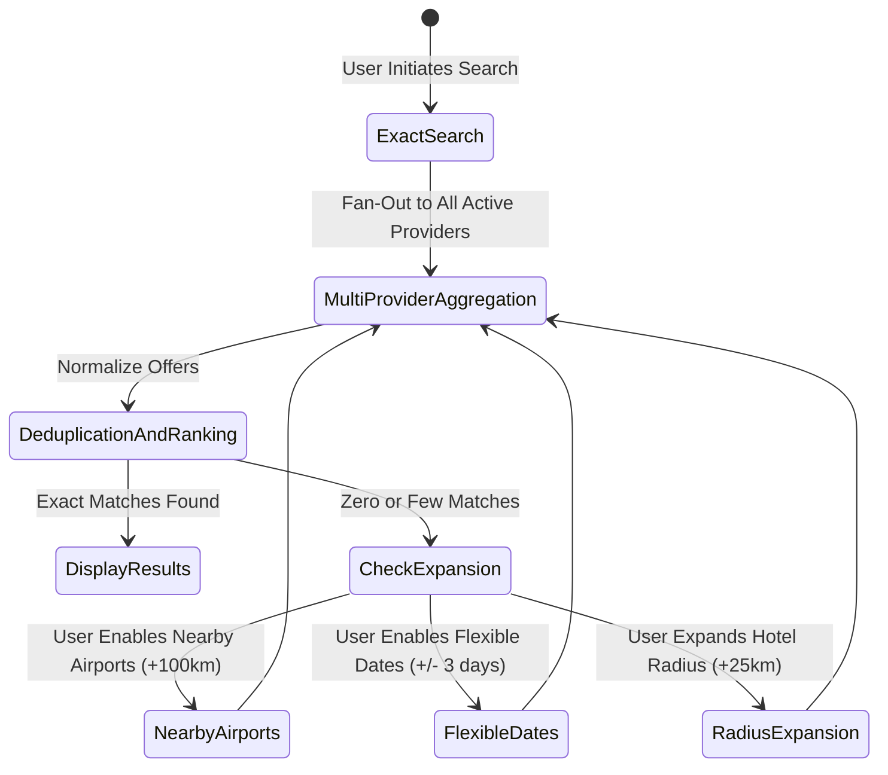
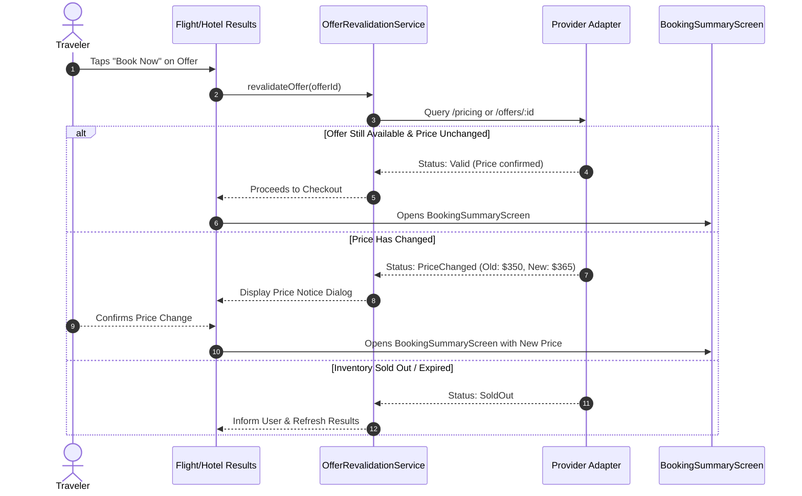

# TRAVELGO — Advanced Multi-Source Search Architecture

**System**: Multi-Platform Travel Search Engine & Aggregation Pipeline  
**Architecture Pattern**: Clean Architecture + Provider Adapter Pattern + Concurrent Aggregator + Progressive Expansion  
**Compliance**: Riverpod v2.x, Zero Client Secrets, Material Design 3, Bilingual RTL/LTR

---

## 1. High-Level Architecture Diagram

```mermaid
flowchart TD
    subgraph UI_Layer["Presentation Layer (Flutter / Riverpod)"]
        FlightUI["FlightSearchScreen & ResultsScreen"]
        HotelUI["HotelSearchScreen & ResultsScreen"]
        UnifiedUI["UnifiedSearchScreen & Map"]
        FlightCtrl["FlightSearchController"]
        HotelCtrl["HotelSearchController"]
        UnifiedCtrl["UnifiedSearchController"]
    end

    subgraph Domain_Core["Core Search Aggregator (Domain Layer)"]
        FlightAggregator["MultiProviderFlightAggregator"]
        HotelAggregator["MultiProviderHotelAggregator"]
        AirportService["AirportLocationService & GeoDistance"]
        FlightDedup["FlightDeduplicator"]
        HotelDedup["HotelDeduplicator"]
        RevalService["OfferRevalidationService"]
        CacheMgr["SearchCacheManager (TTL & Coalescing)"]
    end

    subgraph Provider_Adapters["Provider Adapters Layer"]
        AmadeusAdapter["AmadeusFlightProvider & AmadeusHotelProvider"]
        DuffelAdapter["DuffelFlightProvider & DuffelStayProvider"]
        TravelpayoutsAdapter["TravelpayoutsAffiliateProvider"]
        PartnerDirectAdapter["PartnerDirectHotelProvider"]
        SandboxAdapter["SandboxFlightProvider & SandboxHotelProvider"]
    end

    subgraph Backend_Gateway["Backend API Gateway (Node / Cloud Functions)"]
        AmadeusAPI["Amadeus Self-Service v2/v3 REST APIs"]
        DuffelAPI["Duffel NDC & Stays APIs"]
        TPFeeds["Travelpayouts Affiliate Feeds"]
        LocalDB["Firestore / Partner Properties DB"]
    end

    FlightUI --> FlightCtrl
    HotelUI --> HotelCtrl
    UnifiedUI --> UnifiedCtrl

    FlightCtrl --> FlightAggregator
    HotelCtrl --> HotelAggregator
    UnifiedCtrl --> FlightAggregator
    UnifiedCtrl --> HotelAggregator

    FlightAggregator --> CacheMgr
    HotelAggregator --> CacheMgr

    FlightAggregator --> FlightDedup
    HotelAggregator --> HotelDedup

    FlightAggregator --> AirportService

    FlightAggregator --> AmadeusAdapter
    FlightAggregator --> DuffelAdapter
    FlightAggregator --> TravelpayoutsAdapter
    FlightAggregator --> SandboxAdapter

    HotelAggregator --> AmadeusAdapter
    HotelAggregator --> DuffelAdapter
    HotelAggregator --> PartnerDirectAdapter
    HotelAggregator --> TravelpayoutsAdapter
    HotelAggregator --> SandboxAdapter

    AmadeusAdapter -.-> AmadeusAPI
    DuffelAdapter -.-> DuffelAPI
    TravelpayoutsAdapter -.-> TPFeeds
    PartnerDirectAdapter -.-> LocalDB

    FlightUI --> RevalService
    HotelUI --> RevalService
```



---

## 2. Core Abstractions & Interfaces

### 2.1. Provider Interfaces (Segregated)

Unlike the previous monolithic `TravelProvider`, providers are segregated according to the Single Responsibility and Interface Segregation principles:

- **`FlightSearchProvider`**:
  ```dart
  abstract class FlightSearchProvider {
    String get providerId;
    String get providerName;
    ProviderType get providerType; // direct, gds, ndc, affiliate, sandbox

    Future<ProviderSearchResult<FlightOffer>> searchFlights(
      FlightSearchParams params, {
      Duration timeout = const Duration(seconds: 8),
    });

    Future<OfferRevalidationResult<FlightOffer>> revalidateOffer(String offerId);
  }
  ```

- **`HotelSearchProvider`**:
  ```dart
  abstract class HotelSearchProvider {
    String get providerId;
    String get providerName;
    ProviderType get providerType;

    Future<ProviderSearchResult<HotelOffer>> searchHotels(
      HotelSearchParams params, {
      Duration timeout = const Duration(seconds: 8),
    });

    Future<OfferRevalidationResult<HotelOffer>> revalidateOffer(String offerId);
  }
  ```

- **`AirportLocationProvider`**:
  ```dart
  abstract class AirportLocationProvider {
    Future<List<Airport>> searchAirports(String query);
    Future<Airport?> findByIata(String iataCode);
    Future<List<Airport>> findNearbyAirports(double lat, double lon, {double radiusKm = 100});
    Future<List<Airport>> findAirportsForCity(String cityCodeOrName);
  }
  ```

---

## 3. Concurrency, Timeouts & Error Isolation

1. **Concurrent Multi-Provider Fan-Out**:
   - When a search is triggered, the aggregator queries all configured providers in parallel using `Future.wait`.
2. **Individual Provider Timeout**:
   - Each provider is bounded by a strict timeout (default: 8.0 seconds).
   - If a provider exceeds this deadline, a `ProviderTimeoutException` is caught gracefully.
3. **Partial Results Delivery**:
   - If Provider A succeeds in 1.2s and Provider B times out or returns an error, the search still succeeds, returning Provider A's verified offers.
   - The UI displays an informational badge: *"Showing 8 offers from 2 providers (1 provider timed out)"* with a non-intrusive retry option.
4. **Search Cancellation (Debounce / Invalidation)**:
   - If the user modifies search parameters while a query is in-flight, the active search token is cancelled, ignoring late responses to prevent race conditions.

---

## 4. Progressive Search & Expansion Strategy



- **Stage 1 (Exact Match)**: Executes strict search with user-specified airport codes and dates.
- **Stage 2 (Optional Nearby Expansion)**: If enabled or suggested, calculates great-circle distance to nearby airports (e.g. JFK + EWR + LGA for New York; CDG + ORY for Paris; LHR + LGW + STN for London) and presents them clearly marked as **Alternative Airport Matches**.
- **Stage 3 (Optional Flexible Dates)**: Queries dates +/- 3 days and displays a flexible date comparison matrix.

---

## 5. Normalized Domain Models

### 5.1. `FlightOffer` (Normalized)
- Unique `id` + `providerId`.
- Marketing airline, operating airline, flight number.
- Departure airport, arrival airport, local departure/arrival ISO timestamps, time zone offsets.
- Total duration (`Duration`), total stops (`int`), layovers (`List<FlightLayover>`).
- Segments (`List<FlightSegment>`).
- Cabin class, fare family (e.g. Light, Classic, Flex).
- Baggage allowance (`BaggageAllowance` with pieces, weight, carry-on).
- Refundability (`bool isRefundable`, change policy).
- Pricing: `baseFareUSD`, `taxesUSD`, `serviceFeeUSD`, `totalUSD`, original currency and converted amounts.
- Booking Channel: `BookingChannel.direct` (in-app checkout) vs `BookingChannel.affiliate` (outbound verified partner link).
- Provenance & Freshness: `retrievedAt`, `expiresAt`, `isRevalidated`.

### 5.2. `HotelOffer` (Normalized)
- Unique `id` + `providerId`.
- Property name, multilingual names (`nameEn`, `nameAr`), address, coordinates (`GeoCoordinates`).
- Star rating (`int`), guest rating (`double`), review count (`int`).
- Room name (`roomName`), room type (`roomType`), max occupancy (`maxGuests`).
- Check-in date, check-out date, number of nights (`nights`).
- Pricing: `pricePerNightUSD`, `taxesPerNightUSD`, `totalStayUSD` (strictly normalized to prevent per-night vs total-stay confusion).
- Board basis (`BoardBasis.roomOnly`, `breakfastIncluded`, `halfBoard`, `allInclusive`).
- Cancellation policy (`isFreeCancellation`, cancellation deadline).
- Amenities list, image gallery.
- Booking Channel: `BookingChannel.direct` vs `BookingChannel.affiliate`.

---

## 6. Deduplication Logic

1. **Flight Deduplication (`FlightDeduplicator`)**:
   - Two flight offers from different providers are considered identical if they have the exact same:
     - Origin airport code and destination airport code.
     - Scheduled departure time (within +/- 10 minutes tolerance for GDS scheduling shifts).
     - Marketing airline and primary flight number.
     - Cabin class.
   - When duplicate offers are detected, they are merged into a single multi-source card, highlighting the lowest available fare while retaining direct booking and partner booking options.

2. **Hotel Deduplication (`HotelDeduplicator`)**:
   - Two hotel offers are considered identical if:
     - Their GPS coordinates are within 150 meters (Haversine distance formula), OR
     - Normalized names match with high similarity (Levenshtein / Token-Sort >= 0.88).
   - The winner is selected based on:
     1. Partner Direct listing with confirmed in-app inventory.
     2. Lowest comparable total stay price.

---

## 7. Pre-Booking Revalidation Pipeline



---

## 8. Directory & File Organization

The new code resides cleanly within the architecture guidelines of `AGENTS.md`:

```
lib/
├── core/
│   └── search/
│       ├── adapters/
│       │   ├── amadeus_flight_provider.dart
│       │   ├── amadeus_hotel_provider.dart
│       │   ├── duffel_flight_provider.dart
│       │   ├── duffel_stay_provider.dart
│       │   ├── travelpayouts_affiliate_provider.dart
│       │   ├── partner_direct_hotel_provider.dart
│       │   └── sandbox_travel_provider.dart
│       ├── aggregators/
│       │   ├── flight_search_aggregator.dart
│       │   └── hotel_search_aggregator.dart
│       ├── domain/
│       │   ├── entities/
│       │   │   ├── flight_offer.dart
│       │   │   ├── hotel_offer.dart
│       │   │   ├── provider_search_result.dart
│       │   │   └── revalidation_result.dart
│       │   ├── providers/
│       │   │   ├── flight_search_provider.dart
│       │   │   ├── hotel_search_provider.dart
│       │   │   └── airport_location_provider.dart
│       │   └── services/
│       │       ├── airport_location_service.dart
│       │       ├── flight_deduplicator.dart
│       │       ├── hotel_deduplicator.dart
│       │       ├── offer_revalidation_service.dart
│       │       └── search_cache_service.dart
│       └── models/
│           ├── iata_airport_database.dart
│           └── search_metrics.dart
```
