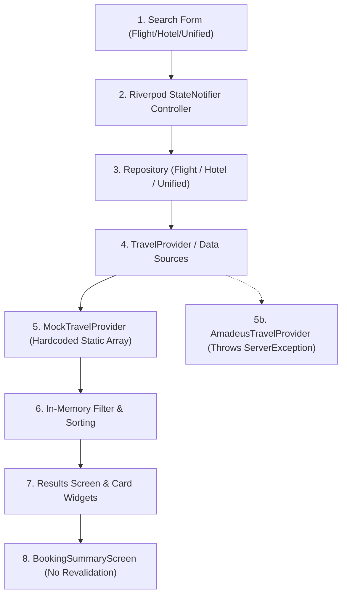

# TRAVELGO — Comprehensive Flight & Hotel Search Engine Audit

**Audit Date**: October 2026  
**Auditor**: Senior Travel Technology Architect, Flutter Engineer & API Integration Specialist  
**Target Repository**: `tahar1208guelma/travelgo`  
**Scope**: Full end-to-end trace of flight, hotel, and unified search pipelines from UI entry to provider ingestion, deduplication, ranking, and booking verification.

---

## 1. Executive Summary

An exhaustive audit of the TRAVELGO search codebase revealed that the current search system is severely restricted by **monolithic provider abstractions**, **hardcoded in-memory catalogs**, **absence of multi-provider concurrency in flight and hotel flows**, **lack of real-time price revalidation**, and **overly simplistic location models** (e.g. only 10 airports worldwide). 

While the UI is clean and responsive, **no real-time live travel inventory is currently retrieved from external travel aggregators or GDS networks**. Instead, every flight search returns the same 6 hardcoded mock flights, and every hotel search returns the same 4 mock properties plus local partner listings.

This document traces the complete search lifecycle, identifies all architectural bottlenecks, and provides the blueprint for the multi-provider, multi-source search architecture.

---

## 2. End-to-End Search Pipeline Trace

### Trace Breakdown by Layer:
1. **Search Form**: User selects inputs in `FlightSearchScreen`, `HotelSearchScreen`, or `UnifiedSearchScreen`. Airport selection is confined to a static 10-airport array. Hotel destination is a plain text field without coordinates or radius.
2. **Controller**: Riverpod `FlightSearchController` and `HotelSearchController` manage search parameters and trigger queries. They hold a single reference to `FlightRepositoryImpl` and `HotelRepositoryImpl`.
3. **Repository**: Repositories simply delegate queries to a single `TravelProvider` instance (`MockTravelProvider`). No concurrent multi-provider orchestration exists.
4. **Provider Layer**: `TravelProvider` is a monolithic interface combining flight search, hotel search, direct booking, and affiliate links into one class.
5. **Data Ingestion**: `MockTravelProvider` returns static mock lists (6 flights, 4 hotels). `AmadeusTravelProvider` unconditionally throws `ServerException('Production backend gateway not connected yet.')`.
6. **Normalization & Deduplication**: No deduplication exists for flight or hotel searches. In `UnifiedSearchRepositoryImpl`, an isolated `SearchDeduplicator` runs basic string regex matching on 11 hardcoded items across 3 mock datasources.
7. **Ranking & Display**: Results are sorted client-side by basic numeric properties (price, duration, rating).
8. **Booking**: `BookingSummaryScreen` accepts prices directly from the original search results without pre-booking revalidation.

---

## 3. Detailed Component Audit & Root Causes

### 3.1. Flight Search Flow
- **Screens**:
  - `lib/features/flights/presentation/screens/flight_search_screen.dart` (lines 20–140)
  - `lib/features/flights/presentation/screens/flight_results_screen.dart` (lines 15–120)
- **Controller**:
  - `lib/features/flights/presentation/controllers/flight_search_controller.dart` (lines 106–153)
- **Repository & Domain**:
  - `lib/features/flights/data/repositories/flight_repository_impl.dart` (lines 10–25)
  - `lib/features/flights/domain/entities/flight_search_params.dart` (lines 4–98)
  - `lib/features/flights/domain/entities/flight_entity.dart` (lines 1–70)
- **Root Causes of Inaccuracy & Limited Results**:
  1. **Zero Multi-Provider Concurrency**: `flightRepositoryProvider` (line 110) delegates strictly to a single `_provider.searchFlights(params)`. There is no concurrent fan-out to multiple airline APIs or aggregators.
  2. **Static 6-Flight Ceiling**: `MockTravelProvider.searchFlights()` (lines 25–176) returns exactly 6 flights (Emirates, Qatar Airways, Turkish Airlines, Air Algérie, Saudia, British Airways) with fixed departure hours, regardless of the route or dates selected.
  3. **Missing Parameter Capabilities**: `FlightSearchParams` lacks flexible dates (`+/- 3 days`), nearby airports flag, maximum stops, preferred airlines, baggage requirements, and departure/arrival time windows.
  4. **No Deduplication**: When multiple flights share identical flight numbers or routing, there is no normalization or deduplication engine.
  5. **No Pagination**: Results are loaded once; no continuation tokens or infinite scroll exist.
  6. **Airport Autocomplete Bottleneck**: `AirportPickerSheet` (lines 31–50) filters against `Airport.majorAirports`, which contains only **10 airports worldwide** (`ALG`, `DXB`, `IST`, `CDG`, `LHR`, `RUH`, `JED`, `CAI`, `DOH`, `JFK`). Searching for any other IATA code (e.g. `FRA`, `MAD`, `AMS`, `ORD`, `HND`, `SYD`) returns zero results.

---

### 3.2. Hotel Search Flow
- **Screens**:
  - `lib/features/hotels/presentation/screens/hotel_search_screen.dart` (lines 18–100)
  - `lib/features/hotels/presentation/screens/hotel_results_screen.dart` (lines 14–100)
- **Controller**:
  - `lib/features/hotels/presentation/controllers/hotel_search_controller.dart` (lines 114–165)
- **Repository & Domain**:
  - `lib/features/hotels/data/repositories/hotel_repository_impl.dart` (lines 10–25)
  - `lib/features/hotels/domain/entities/hotel_search_params.dart` (lines 1–85)
  - `lib/features/hotels/domain/entities/hotel_entity.dart` (lines 1–80)
- **Root Causes of Inaccuracy & Limited Results**:
  1. **Single Provider Delegation**: `hotelRepositoryProvider` only queries `travelProviderRef`, returning 4 static mock hotels (`Burj Al Arab`, `Ritz Paris`, `Çırağan Palace Kempinski`, `Sofitel Algiers`).
  2. **No Geographic Coordinate or Radius Search**: `HotelSearchParams` only contains a text `destination` string (lines 2, 73). It does not support latitude, longitude, search radius (e.g., 5km, 25km), districts, or landmarks.
  3. **Crude Partner Combination Without Deduplication**: In `HotelSearchController.searchHotels()` (lines 144–159), partner hotels from `HotelPartnerRepository` are combined with provider results via simple list concatenation (`final combined = [...matchingPartners, ...results]`). If a partner hotel is also listed by an OTA or GDS provider, it appears twice.
  4. **Missing Occupancy Granularity**: `HotelSearchParams` lacks child ages (`childAges`), which are mandatory for accurate hotel pricing in Amadeus, Duffel, and Booking.com APIs.
  5. **No Pagination or Radius Expansion**: Cannot expand the search area when zero or few results are found in the immediate city center.

---

### 3.3. Unified Search Flow
- **Files**:
  - `lib/features/unified_search/data/datasources/amadeus_search_datasource.dart` (lines 3–88)
  - `lib/features/unified_search/data/datasources/booking_affiliate_datasource.dart` (lines 3–92)
  - `lib/features/unified_search/data/datasources/local_search_datasource.dart` (lines 3–142)
  - `lib/features/unified_search/data/repositories/unified_search_repository_impl.dart` (lines 13–155)
  - `lib/features/unified_search/domain/services/search_cache_manager.dart` (lines 14–73)
  - `lib/features/unified_search/domain/services/search_deduplicator.dart` (lines 3–70)
- **Root Causes & Limitations**:
  1. **Fabricated Catalogs**: Despite claiming to query "Amadeus API" and "Booking.com Affiliate Network", `AmadeusSearchDataSource` and `BookingAffiliateDataSource` only query static in-memory lists of 3 items each. Total inventory across all 3 data sources is exactly 11 items.
  2. **Excessive 1-Hour Cache TTL**: `SearchCacheManager` caches responses for `defaultTTL = Duration(hours: 1)` (lines 20, 60). Caching real-time flight and hotel inventory for 1 hour violates rate freshness rules and causes travelers to see stale fares that may no longer be available.
  3. **Fragile Deduplication**: `SearchDeduplicator` relies on stripping words like `hotel`, `resort`, `spa` with regex and checking GPS distance <= 250m. If coordinates are missing (or (0,0)), it risks false positive matches. Furthermore, this deduplicator is only invoked in `UnifiedSearchRepository`, completely bypassing flight and hotel search screens.

---

### 3.4. Backend & Security Architecture
- **Files**:
  - `lib/providers_layer/amadeus_provider.dart` (lines 12–57)
  - `backend/` directory (empty except for local node_modules)
- **Root Causes**:
  1. **Unimplemented Backend Gateway**: `AmadeusTravelProvider` references `https://api.travelgo.app/v1`, but no backend proxy service is running or configured.
  2. **Monolithic Provider Interface**: `TravelProvider` forces any provider adapter to implement both flights, hotels, bookings, and affiliate tracking. This breaks the Interface Segregation Principle (ISP) because dedicated flight providers (e.g. Duffel Flights) or hotel providers (e.g. Duffel Stays, Booking.com) are forced to stub out unrelated methods.

---

### 3.5. Booking Revalidation & Integrity
- **Files**:
  - `lib/features/bookings/presentation/screens/booking_summary_screen.dart` (lines 70–120)
  - `lib/features/bookings/presentation/screens/booking_confirmation_screen.dart`
- **Root Causes**:
  1. **Zero Pre-Checkout Revalidation**: When a user selects a flight or hotel, the price and availability passed into `BookingSummaryScreen` are static parameters from the search result card. The app never calls `revalidateOffer(offerId)` to check whether the seat/room remains available at that price before charging the card.
  2. **Financial Integrity Risk**: If inventory sells out or prices change dynamically on the airline/hotel GDS, the booking attempt will fail at payment time or create an unconfirmable reservation.

---

## 4. Key Metrics & Defect Matrix

| Area | Current Implementation | Severity | Architectural Requirement |
| :--- | :--- | :--- | :--- |
| **Provider Architecture** | Monolithic `TravelProvider`, single active instance (`MockTravelProvider`) | **Critical** | Segregated adapters (`FlightSearchProvider`, `HotelSearchProvider`), concurrent aggregation |
| **Data Authenticity** | 100% hardcoded mock data (6 flights, 4 hotels, 11 unified items) | **Critical** | Real-world API adapters (Amadeus v2, Duffel, Travelpayouts, Partner Direct) with graceful fallback |
| **Airport Coverage** | Static list of 10 airports worldwide | **High** | Comprehensive IATA airport/city database, multi-airport cities, coordinate distance |
| **Search Flexibility** | Exact dates and origin/dest only | **High** | Flexible dates (+/- 3 days), nearby airports expansion, radius expansion |
| **Deduplication** | Absent in flight/hotel; crude regex in unified search | **High** | Segment/flight-number deduplication for flights; normalized geo+fuzzy deduplication for hotels |
| **Cache Management** | 1-hour static TTL in unified search; 0 caching elsewhere | **Medium** | Configurable short-lived TTL (5–10 min for search, 24h for reference), in-flight coalescing |
| **Pre-Booking Revalidation** | None | **Critical** | Step 1: Revalidate price & availability before `BookingSummaryScreen` checkout |
| **Error & Timeout Handling** | All-or-nothing failure; no timeout configuration | **Medium** | Partial results: if 1 provider times out, return successful results from others |

---

## 5. Remediation Roadmap

1. **Phase 2 — Multi-Provider Core**: Design `FlightSearchProvider`, `HotelSearchProvider`, and `AirportLocationProvider` contracts with timeouts, rate limits, metrics, and partial result aggregation.
2. **Phase 3 — Flight Search Engine**: Implement comprehensive IATA database with multi-airport cities, nearby airport calculation, flexible date queries, and standardized flight offer normalization.
3. **Phase 4 — Hotel Search Engine**: Implement coordinate-based radius search, child ages, per-night vs total-stay math, and standardized hotel offer normalization.
4. **Phase 5 — Provider Adapters**: Build adapters for Amadeus Self-Service v2/v3, Duffel, Travelpayouts/Affiliate, Partner Direct, and Sandbox/Mock.
5. **Phase 6 — Normalization & Deduplication**: Unified offer models and cross-provider deduplication preserving multi-channel booking options.
6. **Phase 7 — Progressive Search Strategy**: Exact matches -> multi-provider -> nearby airports -> flexible dates.
7. **Phase 8 — Revalidation Engine**: Pre-checkout price and seat/room verification.
8. **Phase 9 — Performance & UX**: Short-lived TTL caching, debouncing, active filter counts, provider provenance badges, and graceful degradation UI.
